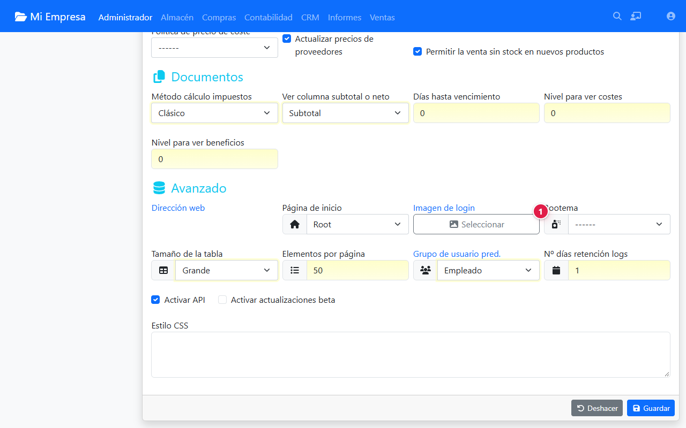
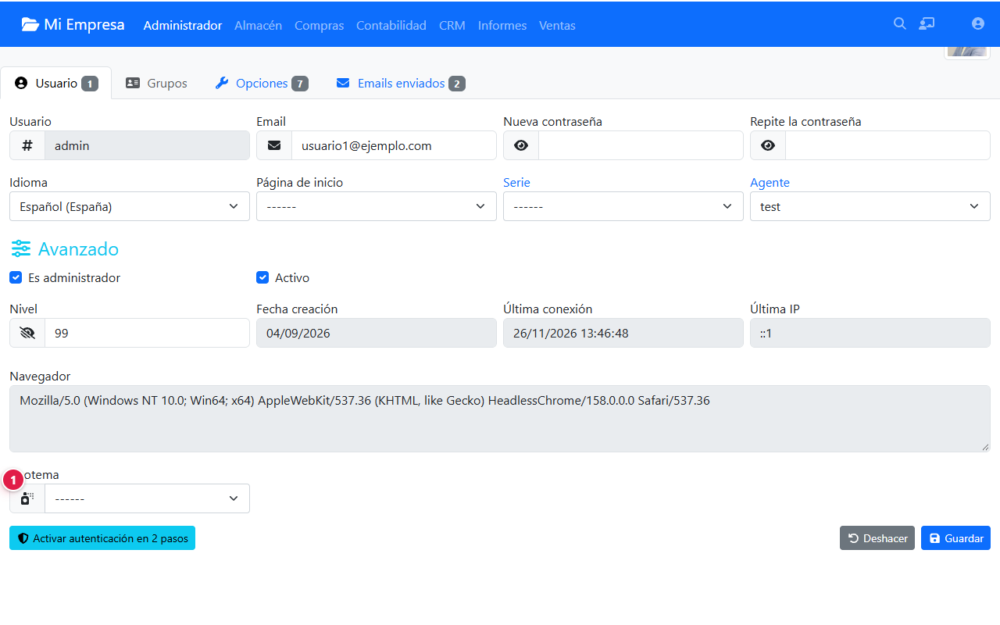

Con el plugin Bootemas podrás cambiar el color y el estilo de tu instalación. Escoge entre sus más de 20 diseños diferentes y personaliza la vista a tu gusto.

## ✅ Activar el plugin
Si todavía no has activado el plugin, ve al **menú Administrador → Plugins**, busca **Bootemas** y pulsa el botón Activar.

## 🎨 Cambiar el tema global
Desde el **menú Administrador → Panel de control**, en la parte de Avanzado, al final de la configuración, ahora verás el campo **bootema**, donde podrás escoger el diseño desde el listado.

### 🙋‍♀️ Cambiar el tema para cada usuario
Si prefieres aplicar el diseño solamente para ti o para algún usuario, con este plugin cada usuario puede tener su diseño. Ve al **menú Administrador → Usuarios**, haz clic en el usuario y, en el campo **bootema**, puedes seleccionar el diseño para ese usuario.

